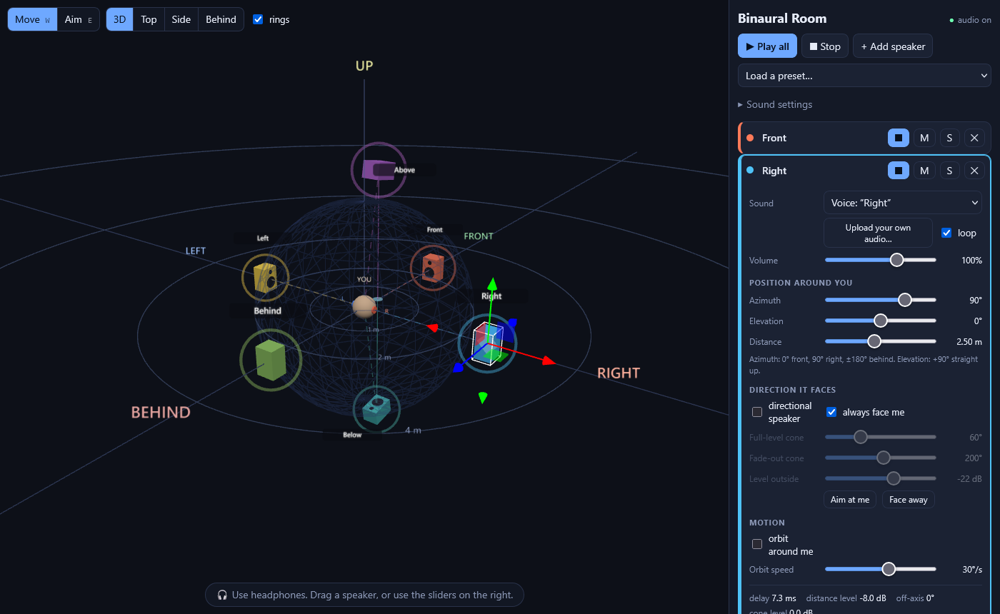
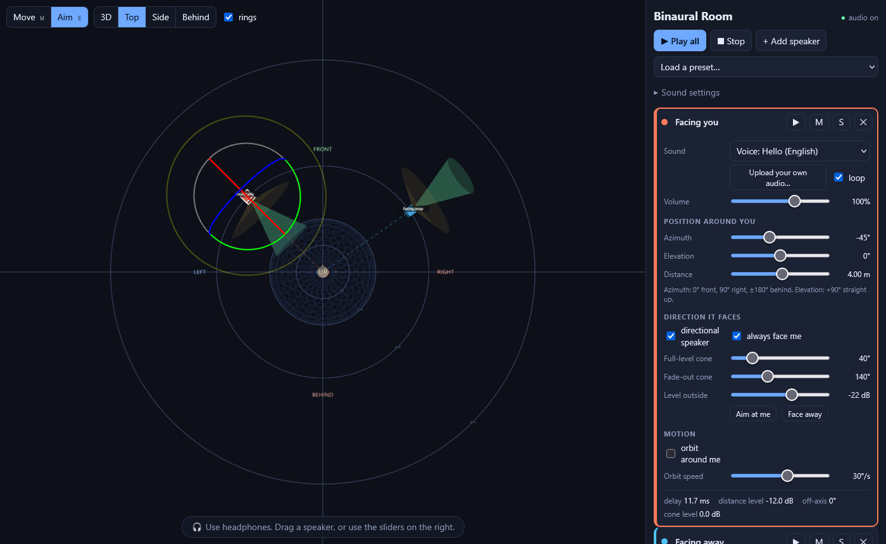
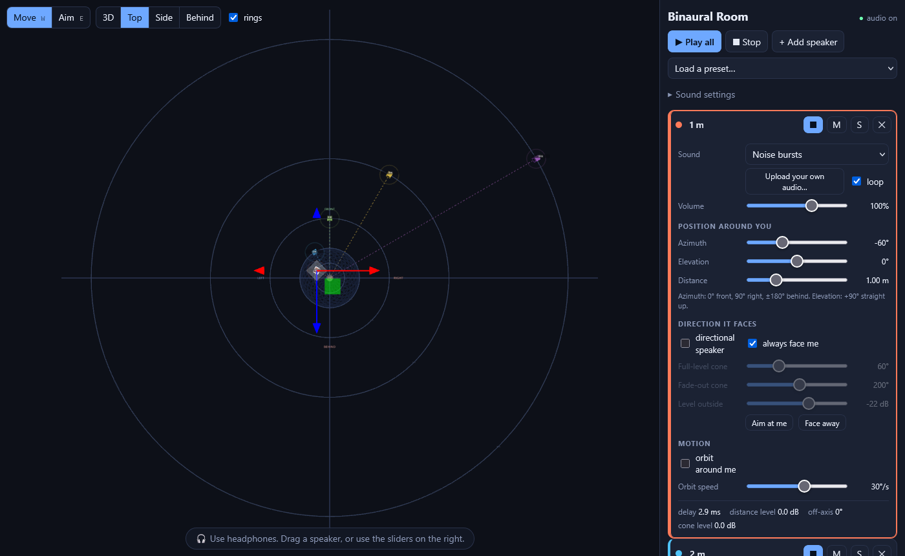
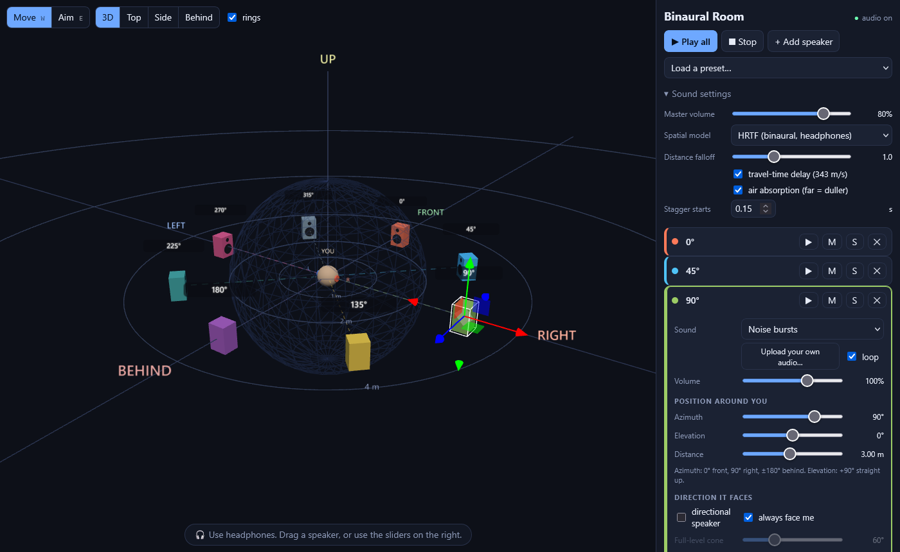

# 🎧 Binaural Sound Simulator

Put sounds in a 3D space around your head and hear where they are.

### 👉 [Try it live](https://itstomekk.github.io/binaural-sound-simulator/) (put on headphones first)

You stand at the centre of a virtual open space. Drop speakers anywhere around you: in front, behind, above, below, near or far. Give each one a voice, a sound effect or your own audio file. Put on headphones and listen.

## ✨ What you can do

- 🔊 Place several speakers at once, each with its own sound, volume and position.
- 🖱️ Drag speakers in the 3D view, or type the position with sliders: azimuth, elevation, distance.
- 🧭 Switch any speaker to **directional**, then aim it. It sounds louder and brighter when it faces you.
- 🔄 Make a speaker orbit around you.
- 📂 Drop in your own audio files (mp3, wav, ogg, m4a).
- 🎓 Try the presets: *Axis test* (a voice says “front, behind, above, below, left, right” from that direction), *Circle of 8*, *Distance ladder*, *Cocktail party*.

## 📸 Screenshots

**Directional speakers.** The cone shows where a speaker is loud. One speaker faces you, the other faces away and sounds much quieter.

**Distance.** Far sources get quieter, duller and arrive later. The rings are 1, 2, 4, 8 and 16 metres.

**Circle of 8 and sound settings.** Switch between HRTF and plain stereo panning to hear the difference.

## 🚀 Start

Use the [live version](https://itstomekk.github.io/binaural-sound-simulator/), or run it yourself:

Open `index.html` in a browser (Chrome, Edge or Firefox). No install, no server.
Press **Play all**, or ▶ on one speaker.

⌨️ Keys: `W` move, `E` aim, `Space` play or stop, `Delete` remove the selected speaker.

## 🎯 Good to know

- Headphones are needed. Speakers cannot reproduce binaural sound properly.
- The head model is generic. Front/back and up/down cues work differently from person to person.
- This is an open space: no walls or echoes yet. They are planned.

Technical notes for developers are in [DEVELOPMENT.md](DEVELOPMENT.md).
